  
    
  
  
  
  
  
    
  

    <a href="#flagship-systems"><b>Flagships</b></a> ·
    <a href="#1-multi-agent-orchestration-mcp--agentic-protocols"><b>Multi-Agent &amp; MCP</b></a> ·
    <a href="#2-llmops-agentops--confidence-calibration"><b>LLMOps &amp; Eval</b></a> ·
    <a href="#3-agentic-ai-for-financial-services--quantitative-risk"><b>FinTech AI</b></a> ·
    <a href="#4-ai-security-adversarial-ml-red-teaming--governance"><b>AI Security &amp; GRC</b></a> ·
    <a href="#5-production-mlops-reproducible-workflows--drift-monitoring"><b>MLOps</b></a> ·
    <a href="#6-cloud-architecture-serverless-ai--software-engineering"><b>Cloud &amp; SWE</b></a>
  

  

    
    
    
    
    
    
    
    
    
    
    
  

  

---

### Flagship Systems

| System | Architectural Focus & Verified Benchmarks | Stack | Verification |
|:---|:---|:---|:---:|
| **[Guarded SalesOps Agent Runtime](https://github.com/kenseiAmit/guarded-salesops-agent-runtime)** | Defense-in-depth B2B CRM runtime enforcing pre/post-inference guardrails, AST Python sandboxing, HITL email gates, multi-tenant SQLite state isolation, and PII-redacted tracing (`14/14` eval pass, `0` leaks). | `Claude` · `Pydantic` · `AST Sandbox` · `SQLite` · `Docker` |  |
| **[Production RAG Gateway & Cost Controls](https://github.com/kenseiAmit/rag-gateway-eval-cost-controls)** | Production LLMOps FAQ gateway (`235` tests) achieving **`61.9%` tiered-routing cost savings**, **`1.4 ms` Chroma semantic cache hits**, `1.000` RAGAS faithfulness/recall, and Arize Phoenix OTel tracing. | `FastAPI` · `ChromaDB` · `RAGAS` · `Arize Phoenix` · `LLM Guard` | `v1.0.0` |
| **[Multi-Agent Banking System (A2A + LangGraph)](https://github.com/kenseiAmit/multi-agent-banking-system)** | Decoupled retail banking microservices (`manager`, `deposit`, `loan`) over Agent-to-Agent (A2A) JSON-RPC + MCP SQL Toolbox, paired with a LangGraph router and deterministic underwriting math (`18/18` A2A pass). | `Google ADK` · `A2A` · `LangGraph` · `MCP` · `Vertex AI` |  |
| **[TRACE: FinCEN AML & SAR Engine](https://github.com/kenseiAmit/trace-aml-sar-compliance-engine)** | Two-stage financial crime investigation & FinCEN SAR engine (`31/31` tests, `10` verified SARs `<=120w`, **`50%` HITL stage-2 compute avoidance**, regex-bounded statutory citations, SHA-256 JSONL audit logs). | `OpenAI` · `Pydantic v2` · `CoT / ReACT` · `SHA-256` |  |
| **[AWS Bedrock RAG Security & Guardrails](https://github.com/kenseiAmit/bedrock-rag-threat-modeling-guardrails)** | Enterprise Bedrock Knowledge Base & Claude Sonnet 4.5 hardening: STRIDE-ML threat model, ML-BOM provenance, explicit-deny IAM scoping, AgentCore tool lockdown, and **`36/36` adversarial interception**. | `AWS Bedrock` · `Guardrails` · `IAM` · `CloudWatch` | `v1.0.0` |
| **[HealthGuard Clinical AI Governance](https://github.com/kenseiAmit/clinical-ai-governance-fairness-audit)** | Intersectional clinical ML fairness & EU AI Act Annex III portfolio (`34/34` tests): TreeSHAP proxy bias proof and counterfactual retraining (**`-31.4 pp` Medicaid–Private FNR gap reduction**). | `Scikit-Learn` · `TreeSHAP` · `EU AI Act` · `MITRE ATLAS` |  |
| **[Claude Extraction Eval & Calibration](https://github.com/kenseiAmit/claude-extraction-eval-observability)** | 3-package Claude evaluation monorepo (`104/104` tests) featuring `policy_type × field` sliced Brier calibration (catching `0.865` overconfidence), blind second-model review, and timeout-isolated synthesis. | `Claude Haiku 4.5` · `Brier Eval` · `Pytest` · `Mypy` |  |

---

### Engineering Portfolio by Domain

#### 1. Multi-Agent Orchestration, MCP & Agentic Protocols
- **[multi-agent-banking-system](https://github.com/kenseiAmit/multi-agent-banking-system)**  — Decoupled Google ADK banking microservices over A2A JSON-RPC + MCP MySQL Toolbox + LangGraph `StateGraph` + `TotalValueAgent` equity math.
- **[claude-multiagent-pr-reviewer](https://github.com/kenseiAmit/claude-multiagent-pr-reviewer)**  — Bounded TypeScript multi-agent GitHub PR code review orchestrator built on Claude Agent SDK + GitHub/ESLint MCP servers, sliding-window rate limiting, and Zod report validation.
- **[adk-research-workflow-engine](https://github.com/kenseiAmit/adk-research-workflow-engine)** — 7-stage Google ADK + Vertex AI Gemini autonomous research engine (`3/3` deterministic routing, `17`-source `ParallelAgent` fan-out, `LoopAgent` critic convergence to `0.92`).
- **[adk-retail-concierge-agent](https://github.com/kenseiAmit/adk-retail-concierge-agent)** — Multi-tool retail concierge unifying MCP Database Toolbox parameterized MySQL queries, Vertex AI Search chunked RAG, and Google Search `AgentTool` sub-agents.
- **[vectrabank-agentic-rag](https://github.com/kenseiAmit/vectrabank-agentic-rag)** — 6-agent sequential Microsoft Semantic Kernel banking intelligence engine grounded in Azure SQL, Azure Blob, and 6-collection ChromaDB hybrid RAG (`30/30` specialist activations, `7/7` fault-injection checks).
- **[agentquant-timeseries-pipeline](https://github.com/kenseiAmit/agentquant-timeseries-pipeline)** — 4-stage Semantic Kernel + Azure OpenAI `AgentGroupChat` pipeline with outlier filtering, `AnalysisChecker` validation loops, HITL gating, and self-healing `PythonExecutor` plotting.
- **[mcp-llm-pricing-intelligence](https://github.com/kenseiAmit/mcp-llm-pricing-intelligence)** — Multi-server Model Context Protocol (MCP) pricing analyst coordinating a custom FastMCP Firecrawl v2 scraper, SQLite persistence server, and Claude Sonnet 4.5 client.

#### 2. LLMOps, AgentOps & Confidence Calibration
- **[guarded-salesops-agent-runtime](https://github.com/kenseiAmit/guarded-salesops-agent-runtime)**  — Multi-tier runtime guardrails, AST sandboxed CRM analytics execution, HITL outbound communications gate, and redacted telemetry (`237` logged runs, `0` leaks).
- **[rag-gateway-eval-cost-controls](https://github.com/kenseiAmit/rag-gateway-eval-cost-controls)** — FastAPI SSE RAG gateway with RAGAS top-$k$ retrieval sweeps (`1.000` faithfulness & recall), Arize Phoenix OpenTelemetry spans, `1.4 ms` semantic caching, and `61.9%` tiered routing savings.
- **[claude-extraction-eval-observability](https://github.com/kenseiAmit/claude-extraction-eval-observability)**  — 3-package Claude evaluation monorepo (`104` tests) featuring sliced Brier calibration, blind second-model review, cross-field mortgage arithmetic validation, and timeout-isolated supply-chain synthesis.

#### 3. Agentic AI for Financial Services & Quantitative Risk
- **[trace-aml-sar-compliance-engine](https://github.com/kenseiAmit/trace-aml-sar-compliance-engine)**  — Two-stage AML investigation & FinCEN SAR engine (`31/31` tests, `10` verified SARs `<=120` words, `50%` HITL stage-2 compute avoidance, regex-bounded statutory citations, SHA-256 JSONL audit logs).
- **[swiftguard-mt103-fraud-pipeline](https://github.com/kenseiAmit/swiftguard-mt103-fraud-pipeline)** — 4-pattern SWIFT MT103 international wire screening pipeline (Evaluator-Optimizer field repair, 3-agent parallel fraud & ISO 9362 BIC / OFAC / FATF screening, 5-stage prompt chain, Orchestrator-Worker batching).
- **[edgar-rag-financial-analyst-agent](https://github.com/kenseiAmit/edgar-rag-financial-analyst-agent)** — LlamaIndex equity coordinator combining FY2024 SEC Form 10-K vector search (`AAPL`, `GOOGL`, `TSLA`), PII-masked SQLite NL-to-SQL, and live Yahoo Finance telemetry.
- **[agentic-alpha-trading-system](https://github.com/kenseiAmit/agentic-alpha-trading-system)** — 6-agent PydanticAI & Streamlit quantitative equity analysis, Fibonacci/RSI technical tooling, SEC Regulation M compliance, and ACID SQLite/PostgreSQL persistence platform.

#### 4. AI Security, Adversarial ML Red-Teaming & Governance
- **[bedrock-rag-threat-modeling-guardrails](https://github.com/kenseiAmit/bedrock-rag-threat-modeling-guardrails)** — Amazon Bedrock Knowledge Base & Claude Sonnet 4.5 security hardening: STRIDE-ML threat model, ML-BOM provenance, explicit-deny IAM scoping, AgentCore tool lockdown, and `36/36` adversarial guardrail interception.
- **[adversarial-ml-rag-redteam-suite](https://github.com/kenseiAmit/adversarial-ml-rag-redteam-suite)** — Offensive AI red-team suite demonstrating PyTorch FGSM evasion (`94.36% → 27.18%`), `7.92%` label-flip recall collapse, `83.3%` FAISS RAG compensation exfiltration, and Trivy container supply-chain auditing (`804` CVEs).
- **[hardened-rag-agent-security-gateway](https://github.com/kenseiAmit/hardened-rag-agent-security-gateway)** — 5-layer defense-in-depth runtime for a local ChromaDB + Mistral-7B (Ollama) RAG agent mitigating jailbreaks, indirect vector poisoning, and HR DB task hijacking (`8/8` regression pass + OWASP LLM Top 10 & SIEM rules).
- **[clinical-ai-governance-fairness-audit](https://github.com/kenseiAmit/clinical-ai-governance-fairness-audit)**  — Clinical ML fairness & EU AI Act Annex III governance portfolio (`34/34` tests): TreeSHAP proxy bias proof, counterfactual retraining (`-31.4 pp` Medicaid–Private FNR gap reduction), KRIs, MITRE ATLAS, and Schrems II TIA.

#### 5. Production MLOps, Reproducible Workflows & Drift Monitoring
- **[census-income-api](https://github.com/kenseiAmit/census-income-api)**  — Leakage-safe tabular MLOps pipeline with automated subgroup fairness auditing across 8 demographic dimensions, Model Card governance, and gated CI/CD Render deployment.
- **[finbert-sentiment-mlops-service](https://github.com/kenseiAmit/finbert-sentiment-mlops-service)**  — Real-time financial headline sentiment service (`FinBERT`) with DVC pipelines, gated MLflow `@production` promotion, FastAPI + Prometheus metrics, and Deepchecks NLP drift gates.
- **[nyc-rental-pricing-mlflow-pipeline](https://github.com/kenseiAmit/nyc-rental-pricing-mlflow-pipeline)** — Reproducible MLflow + Hydra + Weights & Biases pricing pipeline (`$32.42` val MAE) with Pytest/SciPy KL-divergence data validation gates and multimodal TF-IDF + geospatial pipelines.
- **[credit-card-churn-ml-pipeline](https://github.com/kenseiAmit/credit-card-churn-ml-pipeline)** — Modular OOP & functional credit card attrition pipeline on `10,127` customer profiles (`95%` test accuracy, `0.84` minority churn F1, `10.0/10` Pylint).
- **[automated-ml-drift-risk-monitor](https://github.com/kenseiAmit/automated-ml-drift-risk-monitor)** — Closed-loop corporate attrition monitoring & dynamic retraining service in Python & Flask with raw-comparison F1 drift detection and Cron automation.
- **[Text-Summarizer-Project](https://github.com/kenseiAmit/Text-Summarizer-Project)** — Config-driven 4-stage Hugging Face `PEGASUS` abstractive dialogue summarization training & FastAPI serving pipeline.

#### 6. Cloud Architecture, Serverless AI & Software Engineering
- **[aws-serverless-fraud-ml-pipeline](https://github.com/kenseiAmit/aws-serverless-fraud-ml-pipeline)** — Cloud-native credit card fraud platform migrating PySpark training to AWS Glue 4.0 (`10×` speedup via `.repartition(16).cache()`), S3-triggered Lambda retraining, and ECS Fargate FastAPI inference.
- **[aws-organizations-landing-zone-peering](https://github.com/kenseiAmit/aws-organizations-landing-zone-peering)** — 5-OU AWS Organizations & Control Tower M&A landing zone with Tagging SCPs, AWS Config rules, FinOps Budget freezes, and verified cross-region VPC peering (`56.7 ms` RTT).
- **[aws-bedrock-legal-summarizer-iac](https://github.com/kenseiAmit/aws-bedrock-legal-summarizer-iac)** — Serverless AWS CloudFormation contract summarization pipeline (`2.13s` S3 → Lambda → Bedrock Nova Micro + Llama 3 fallback) and FinOps storage/inference architecture.
- **[adaptive-flashcard-cli](https://github.com/kenseiAmit/adaptive-flashcard-cli)**  — Zero-dependency Python CLI active-recall learning engine implementing Strategy & Factory patterns, bounded adaptive retry queues, and `97%` `pytest` coverage.

---

### Core Technical Stack

- **Agentic AI & Protocols:** Anthropic Claude & Agent SDK · Google ADK · LangGraph / LangChain · Microsoft Semantic Kernel · LlamaIndex · PydanticAI · MCP · A2A JSON-RPC
- **AI Security, Eval & LLMOps:** RAGAS · Arize Phoenix (OpenTelemetry) · AWS Bedrock Guardrails · LLM Guard / Presidio · PyTorch Adversarial ML (FGSM / Poisoning) · SHAP · STRIDE-ML · MITRE ATLAS · EU AI Act GRC
- **Cloud, Data & MLOps:** Python · TypeScript · SQL · PySpark (AWS Glue) · FastAPI · MLflow · DVC · Hydra · Weights & Biases · ChromaDB / FAISS · Docker · CloudFormation · AWS (ECS Fargate, Lambda, S3, Orgs) · GCP (Vertex AI) · Azure AI Foundry
